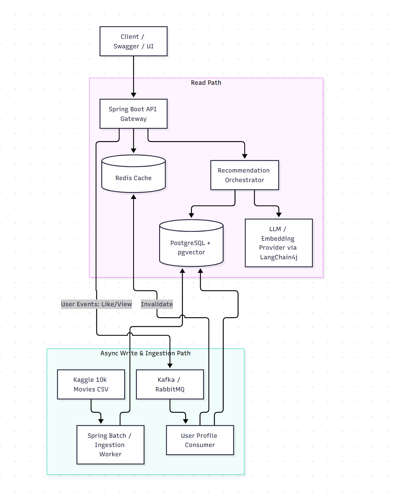

system architecture : AI Native Movie recommendation Engine 

## 1. system overview and goals 

Purpose: A hybrid movie recommendation and semantic search engine built on the TMDB 10,000 Popular Movies dataset, combining dense vector retrieval, deterministic metadata scoring, and LLM-based query parsing/explanation.

Non-Functional Goals (Targets):

Latency: p95 < 150ms for cached/deterministic recommendations; p95 < 1.5s when invoking LLM explanation/re-ranking.

Availability & Degradation: Zero hard failures if external LLM/Embedding APIs time out (graceful fallback to popularity + metadata filtering).

Cost Control: Cache frequent semantic queries and generated explanations to minimize token usage.

## 2. system architecture
flowchart TD
Client[Client / Swagger / UI] --> Gateway[Spring Boot API Gateway]

    subgraph Read Path
        Gateway --> Cache[(Redis Cache)]
        Gateway --> Orchestrator[Recommendation Orchestrator]
        Orchestrator --> VectorDB[(PostgreSQL + pgvector)]
        Orchestrator --> LLM[LLM / Embedding Provider via LangChain4j]
    end
    
    subgraph Async Write & Ingestion Path
        CSV[Kaggle 10k Movies CSV] --> BatchJob[Spring Batch / Ingestion Worker]
        BatchJob --> VectorDB
        Gateway -->|User Events: Like/View| Broker[Kafka / RabbitMQ]
        Broker --> ProfileWorker[User Profile Consumer]
        ProfileWorker --> VectorDB
        ProfileWorker -->|Invalidate| Cache
    end

## 3. Tech Stack & Architectural Trade-offs

Component,Technology Choice,Why This Choice (Trade-off)
Core Backend,Java 21 + Spring Boot,Leverages Virtual Threads for high-concurrency I/O (waiting on LLM/DB calls) without reactive complexity.
AI Integration,LangChain4j (or Spring AI),"Provides clean abstractions, structured outputs, and easy provider swapping (OpenAI / Ollama / Bedrock)."
Primary + Vector DB,PostgreSQL + pgvector,"Keeps relational metadata (release_date, vote_count) and vector embeddings in one ACID database—enables single-query hybrid filtering."
Caching,Redis,Sub-millisecond lookup for hot recommendations and expensive LLM-generated explanations.
Event Streaming,Kafka (or RabbitMQ),"Decouples user interaction writes (LIKED, WATCHED) from the synchronous recommendation read path."

## 4. Data Model & Storage Strategy
movies table: Stores raw + cleaned Kaggle fields (id, title, overview, genres as JSONB/array, original_language, release_date, popularity, vote_average, vote_count), plus a precomputed weighted_rating (Bayesian average) and an embedding (vector(1536) or vector(384)).

user_profiles table: Stores simulated user IDs, preferred genres/languages, and a running user preference embedding (averaged from movies they liked).

user_events table: Append-only log (event_id, user_id, movie_id, event_type, timestamp) for auditability and profile updates.

## 5. Key Request Flows
Flow A: Hybrid Recommendation Read Path (POST /api/v1/recommendations)

Check Redis cache using userId + filterHash. Return immediately on cache hit.

Stage 1 (Candidate Generation): Query pgvector using cosine similarity against the user's preference vector (or natural language query embedding), applying hard SQL WHERE filters (e.g., language = 'en', vote_count > 100) to fetch the top 50 candidates.

Stage 2 (Deterministic Ranking): Re-score the 50 candidates in Java using a weighted formula: 0.5 * semantic_score + 0.3 * normalized_bayesian_rating + 0.2 * recency_boost, excluding already-watched movies.

Stage 3 (AI Explanation): Pass the top 5 movies to the LLM with strict grounding rules to generate a 1-sentence "Why this matches your taste" note, cache the result in Redis, and return.

Flow B: Asynchronous User Feedback Loop (POST /api/v1/events)

API validates the event (LIKED / WATCHED) and publishes it to Kafka/RabbitMQ, returning 202 Accepted immediately.

Background consumer updates user_events, recalculates the user's preference vector, and evicts stale keys in Redis.

## 6. Reliability, Observability & Future Scale

Failure Modes & Fallbacks (Circuit Breaker via Resilience4j):

If Embedding API is down: Fall back to PostgreSQL Full-Text Search (tsvector) + weighted_rating.

If LLM Explanation service times out (> 800ms): Return the ranked movie list without the AI explanation text (explanation: null) rather than failing the request.

Observability: Expose Prometheus/Micrometer metrics for recommendation.latency, cache.hit.ratio, llm.token.usage, and llm.fallback.triggered.count.

Scale Roadmap (10k → 100M movies): Note that while pgvector with an HNSW index easily handles up to a few million vectors, scaling to 100M+ items would require partitioning/sharding or migrating vector search to a dedicated distributed engine (Qdrant/Milvus) alongside an offline feature store.

